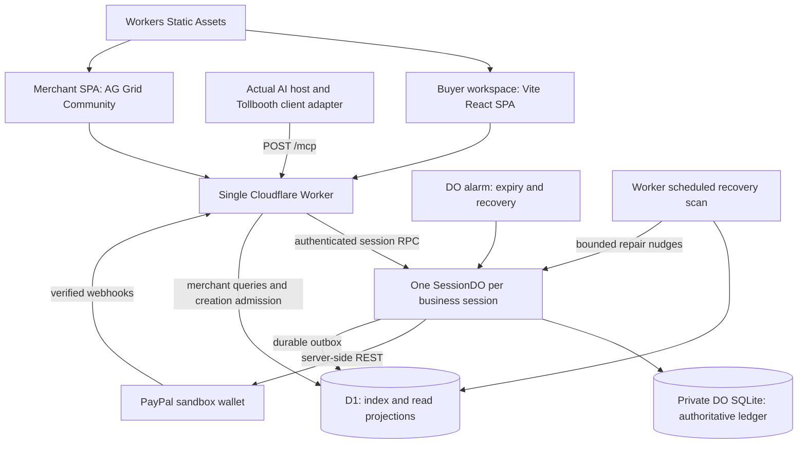
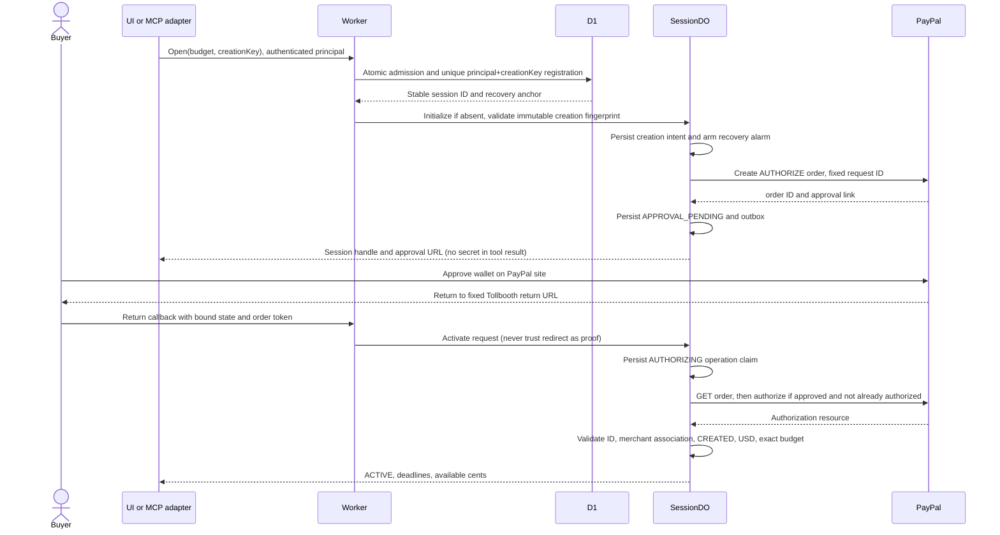
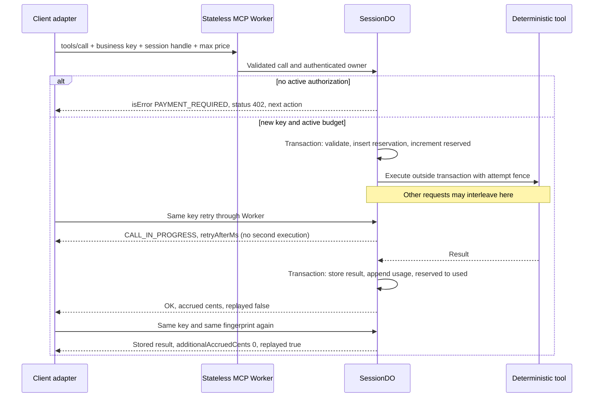
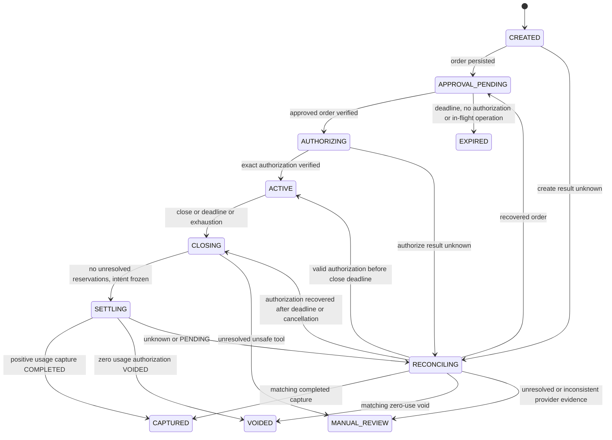

# Tollbooth system design

**Decision date:** 2026-10-18 KST. **Status:** design accepted as the implementation baseline, with explicit owner decisions in [PLAN](PLAN.md). Nothing in this document is a claim of a deployed implementation. Schema descriptions are contracts, not executable migrations.

## 1. Product, boundaries, and evidence

Tollbooth lets a small data provider sell individual MCP tool results without a subscription. The buyer approves a maximum sandbox budget; the service meters successful calls, then performs one logical settlement. The buyer workspace shows execution, the authoritative ledger, available budget, and a receipt. The merchant sees gross captured revenue, sessions, and charges.

Goals: preserve the existing verified money/policy rules; withstand concurrent calls, retries, object eviction, and abandoned browsers; provide actual AI tool selection in the submission; target $0 infrastructure within quotas; finish a coherent solo demo before **2026-11-13 05:00 KST**.

Non-goals: production payments, card acceptance, currencies other than USD, multiple onboarded sellers, marketplace payouts, subscriptions, refunds UI, stored payment credentials, prepaid credit, arbitrary side-effecting tools, guaranteed collection, or universal exactly-once remote execution. No Next.js/OpenNext, McpAgent, paid grid features, or long-lived MCP transport sessions. A deterministic rehearsal remains available and explicitly labeled; it does not satisfy the actual-AI acceptance gate.

### Evidence read for this design

| Local input | Finding and treatment |
|---|---|
| `/Users/arcsolve/aside-runs/paypal-arch-review/REPORT.md` | Adopt A′ and its three risk responses; map them to acceptance gates in section 12. |
| `../paypal-ai-hackathon/app`, baseline `dbac80f` | Read all eight source modules, three test files, policy, README, and sandbox E2E. Preserve rules, replace runtime assumptions. |
| `../paypal-ai-hackathon/_runs/2026-10-18-build/tests.log` | Recorded 57 passing tests: 41 domain/policy, 8 PayPal, 8 MCP. Not rerun in this design task. |
| Same run's `RESULT.md`, `phase-2.json`, and E2E assertions | RESULT describes phase 2 as unfinished; the later phase-2 artifact records PASS: three paid calls, one replay, one USD 0.90 capture, authorization CAPTURED. Treat the later artifact as subsequent evidence, not as a fresh test. |
| `../paypal-ai-hackathon/_runs/2026-10-18-sandbox/flow-out.txt` | Earlier probe records USD 10 authorization, two captures, then void. It proves sandbox API feasibility, not the redesigned single-settlement flow. |
| `../paypal-ai-hackathon/research/ideation/{RESULT,notice,analysis}.md` | Retain provider audience, policy differentiation, five judging dimensions, and demo priorities. Earlier per-call capture/prepaid/Render/Toolkit proposals are superseded by this design. |
| External sandbox environment file | Existence checked only. Contents were not read. |

The recorded “released USD 4.10” means unused authorized amount with final-capture evidence in that run. It is not evidence of a bank/wallet balance posting time. Public documentation must omit private account/resource identifiers from those artifacts.

### Fixed product policies (proposals where not inherited)

- Budget: 50–500 integer USD cents, default 500; fixed prices: `market_lookup` 20 cents and `landed_cost` 35 cents.
- Client policy: per-call cap 50, session cap 500, human approval above 30, allowlist `tollbooth.demo`. The hard caps cannot be overridden by an approval click.
- Approval window: 30 minutes from creation (shorter than the old four hours). Active inactivity: 15 minutes; absolute active lifetime: 30 minutes from authorization, capped by provider expiration with a 60-second safety margin. Reads, failed calls, and replays do not extend activity. These are Tollbooth policies, not PayPal guarantees.
- Maximum 20 successful calls, four concurrent reserved calls, 8 KiB arguments and 16 KiB cached result per call. Request body limit 32 KiB except the separately bounded webhook body. No variable-price tools in the entry.
- Close on explicit user/agent request, expiry, or zero available budget once pending reservations resolve. Disconnect alone does not close the business session.

## 2. Topology and ownership



Bindings planned: `SESSIONS` (SQLite DO namespace), `DB` (D1), `ASSETS`. DO ID derives from deployment environment + configured merchant + server-generated business UUID, never from a raw untrusted arbitrary object name. For a new Worker, current class-lifecycle documentation uses an `exports` entry with `type: durable-object` and `storage: sqlite`; `new_sqlite_classes` belongs to the older migrations flow. Pin a Wrangler version supporting the selected declaration in M1; never combine both configuration mechanisms or delete a namespace to change its storage. Application SQL schema migrations remain forward-only and versioned. See [DO class exports](https://developers.cloudflare.com/durable-objects/reference/durable-objects-migrations/). The Worker validates principal and route; the DO repeats merchant/owner/session binding checks. Direct DO access is not public.

One Worker serves `/mcp`, `/api/*`, `/paypal/*`, and `/webhooks/*` ahead of SPA fallback. Set selective `assets.run_worker_first` for those paths, with SPA not-found handling for UI routes. Unknown API paths return JSON 404, never HTML. Built assets bypass Worker execution where possible; authenticated data uses `Cache-Control: no-store`. See [Static Assets routing](https://developers.cloudflare.com/workers/static-assets/routing/worker-script/).

Session reads and receipts come from DO. D1 is only a query model plus a durable discovery/admission index. D1 failure blocks new orders but cannot override an existing DO's budget. PayPal network work happens within the DO's operation state machine, outside SQL transactions. The same REST adapter can verify webhooks at Worker ingress.

## 3. Request and recovery sequences

### Open, buyer approval, and authorization



Creation retries use the same principal, `creationKey`, budget, provider, and pricing policy. D1 returns the existing ID; a different creation fingerprint is a conflict. Persist the D1 anchor before any financial POST. A crash between registration and DO initialization leaves an inert recoverable row containing the immutable budget/pricing/deadline input; initialization retries are idempotent. Recovery initializes from that row only while its approval deadline is valid; otherwise it marks the untouched registration expired without creating an order. Lost create-order response stays in reconciliation with the original request ID; do not create another order under a new key merely to make the UI progress.

Return/cancel state is single-use, signed, expires with the approval window, and bound to owner + session + a random nonce. Persist its nonce hash before create-order; after the response, bind the returned order ID to that same session. On callback require the PayPal order token to equal that persisted order ID, so no unknown order ID needs to be signed before creation. It grants no spending access. The normal browser requires its same-site owner cookie. Cross-device return shows instructions to resume in the initiating client; it does not transfer ownership. On approval timeout, query order resources: an already existing authorization is persisted and zero-use voided. An approved order without an authorization is simply abandoned; do not create a new hold solely to void it. An in-flight or unknown authorize must resolve before declaring EXPIRED.

### Paid call, parallel reservations, and retries



A changed input/tool/version/accepted quote under the same key returns `IDEMPOTENCY_CONFLICT`. A completed replay is available after closure while authorized access remains valid. A JSON-RPC request ID is never a charge key. Successful results are sent only after durable finalization. Known execution failure releases the reservation and stores FAILED; reusing that key returns `PREVIOUS_CALL_FAILED`.

### Explicit close, timeout, and failure recovery

```mermaid
sequenceDiagram
    participant C as Client
    participant A as Alarm or recovery scan
    participant S as SessionDO
    participant P as PayPal
    participant D as D1
    alt user or agent finishes
        C->>S: Close through authenticated Worker
    else browser disappears or session expires
        A->>S: Resume due job
    end
    S->>S: Transaction: set CLOSING, forbid new reservations
    S->>S: Resolve running calls; freeze final amount only when reserved = 0
    alt positive usage
        S->>S: Persist one CAPTURE settlement and immutable payload/key
        S->>P: Capture exact usage with final_capture true
    else zero usage
        S->>S: Persist one VOID settlement and immutable key
        S->>P: Void authorization
    end
    alt definitive response and validated provider facts
        P-->>S: COMPLETED capture or VOIDED authorization
        S->>S: Commit terminal state and projection outbox
    else timeout, pending, or lost response
        S->>S: RECONCILING; preserve original operation
        A->>S: Later alarm or verified webhook nudge
        S->>P: GET order, authorization, known capture
        P-->>S: Provider facts or still unknown
        S->>S: Complete, reschedule read recovery, or MANUAL_REVIEW
    end
    S->>D: Atomic version-guarded projection batch
    D-->>S: ACK (duplicate-safe)
    S->>S: Mark outbox delivered
    S-->>C: Receipt/status from DO, projection may lag
```

Timeout is not proof of rejection. `CLOSING` survives client disconnect and prevents both a new call and an independent capture/void path. A duplicate alarm, close, webhook, or recovery nudge joins the same operation; none recomputes a frozen amount.

## 4. Durable state model and SQLite schema



`RECONCILING` carries `resume_phase`; it is not permission to reopen. `close_requested_at` is sticky even during AUTHORIZING. `MANUAL_REVIEW` rejects new work but permits authenticated reads and read-only provider reconciliation. Late definitive matching facts may resolve it via the recorded resume phase; an operator cannot simply set “paid.” CAPTURED/VOIDED/EXPIRED are terminal for spending. Later verified refund/reversal facts persist an inbox event and `post_settlement_issue`, flag review, and keep the original captured amount as historical gross (an adjusted net balance is outside this product); they never permit a second settlement.

Implementation confirmation rule: if a completed capture is visible while its authorization GET still reports CREATED, retain RECONCILING and read again with the stored identity. A CAPTURED receipt records the matching CAPTURED authorization status; a conflicting terminal authorization requires review. Never repeat capture to make these views converge.

Each DO contains exactly one session. All timestamps are UTC epoch milliseconds (`INTEGER`), all money is safe integer cents (`INTEGER`), booleans are constrained 0/1, structured blobs are bounded JSON `TEXT`. `?` means nullable; otherwise NOT NULL. No raw access token, buyer email, address, or OAuth token is stored in these tables.

| Table | Columns and constraints |
|---|---|
| `schema_version` | `version INTEGER PRIMARY KEY`, `applied_at INTEGER`. Monotonic forward migrations. |
| `session` | `singleton INTEGER PRIMARY KEY CHECK=1`; `id TEXT UNIQUE`, `owner_id TEXT`, `merchant_id TEXT`, `provider TEXT CHECK IN(sandbox,demo)`, `creation_hash TEXT`, `pricing_version TEXT`, `currency TEXT CHECK=USD`, `budget_cents INTEGER CHECK 50..500`, `used_cents INTEGER DEFAULT 0`, `reserved_cents INTEGER DEFAULT 0`, `state TEXT` (enum above), `version INTEGER`, `created_at INTEGER`, `updated_at INTEGER`, `approval_deadline INTEGER`, `activated_at INTEGER?`, `last_activity_at INTEGER?`, `idle_deadline INTEGER?`, `hard_deadline INTEGER?`, `close_requested_at INTEGER?`, `close_reason TEXT?`, `order_id TEXT? UNIQUE`, `authorization_id TEXT? UNIQUE`, `authorization_expires_at INTEGER?`, `authorization_status TEXT?`, `approval_url TEXT?`, `callback_nonce_hash TEXT`, `callback_consumed_at INTEGER?`, `resume_phase TEXT?`, `post_settlement_issue TEXT?`, `last_error_code TEXT?`. CHECK used>=0, reserved>=0, used+reserved<=budget. |
| `calls` | `call_key TEXT PRIMARY KEY`, `tool TEXT`, `canonical_args TEXT`, `input_hash TEXT`, `pricing_version TEXT`, `accepted_max_cents INTEGER`, `price_cents INTEGER CHECK>0`, `state TEXT CHECK IN(RESERVED,RUNNING,SUCCEEDED,FAILED,UNKNOWN)`, `attempt INTEGER`, `fence INTEGER`, `lease_until INTEGER?`, `reserved_cents INTEGER`, `result_json TEXT?`, `result_hash TEXT?`, `error_code TEXT?`, `created_at INTEGER`, `finished_at INTEGER?`. Hash covers tool, normalized validated args, pricing version, price, accepted maximum. Index `(state,lease_until)`. |
| `ledger` | `seq INTEGER PRIMARY KEY`, `call_key TEXT UNIQUE REFERENCES calls(call_key)`, `amount_cents INTEGER CHECK>0`, `result_hash TEXT`, `committed_at INTEGER`. Immutable successful usage entries only; no failed/reserved rows. Sum equals `session.used_cents`. |
| `payment_operations` | `kind TEXT PRIMARY KEY CHECK IN(CREATE_ORDER,AUTHORIZE)`, `request_id TEXT UNIQUE`, `payload_json TEXT`, `payload_hash TEXT`, `status TEXT CHECK IN(PREPARED,IN_FLIGHT,UNKNOWN,SUCCEEDED,FAILED)`, `resource_id TEXT?`, `attempt INTEGER`, `fence INTEGER`, `lease_until INTEGER?`, `first_sent_at INTEGER?`, `last_error_code TEXT?`, `updated_at INTEGER`. Prepared payload immutable after first send. |
| `settlement` | `singleton INTEGER PRIMARY KEY CHECK=1`, `kind TEXT CHECK IN(CAPTURE,VOID)`, `authorization_id TEXT`, `amount_cents INTEGER`, `currency TEXT CHECK=USD`, `final_capture INTEGER`, `request_id TEXT UNIQUE`, `payload_json TEXT`, `payload_hash TEXT`, `frozen_version INTEGER`, `status TEXT CHECK IN(PREPARED,IN_FLIGHT,UNKNOWN,PENDING,SUCCEEDED,FAILED,REVIEW)`, `capture_id TEXT? UNIQUE`, `provider_status TEXT?`, `release_evidence TEXT? CHECK IN(FINAL_CAPTURE,VOIDED,EXPIRED,UNCONFIRMED)`, `attempt INTEGER`, `fence INTEGER`, `lease_until INTEGER?`, `first_sent_at INTEGER?`, `verified_at INTEGER?`, `last_error_code TEXT?`. CAPTURE requires amount>0 and final_capture=1; VOID requires amount=0 and final_capture=0. |
| `webhook_inbox` | `event_id TEXT PRIMARY KEY`, `event_type TEXT`, `resource_id TEXT`, `body_hash TEXT`, `received_at INTEGER`, `processed_at INTEGER?`, `outcome TEXT`. Only verified events; no full payer payload. |
| `outbox` | `event_id TEXT PRIMARY KEY` = session ID + version, `session_version INTEGER UNIQUE`, `snapshot_json TEXT`, `created_at INTEGER`, `next_attempt_at INTEGER`, `attempts INTEGER`, `delivered_at INTEGER?`. Index `(delivered_at,next_attempt_at)`. Contains redacted session, settlement, and <=20 immutable ledger entries. |
| `jobs` | `kind TEXT PRIMARY KEY CHECK IN(EXPIRY,PAYMENT_RECOVERY,CALL_RECOVERY,PROJECTION)`, `due_at INTEGER`, `attempts INTEGER`, `last_error_code TEXT?`; index `(due_at)`. One row per scheduled responsibility, not one platform alarm each. |

Paid-call transitions, aggregate updates, ledger append, session version, and outbox insert commit together with `ctx.storage.transactionSync`. No network await occurs in that callback. DO SQL does not accept a copied `BEGIN IMMEDIATE`; use the storage transaction API. Short schema initialization may use `blockConcurrencyWhile`; it is not a PayPal mutex. See [SQLite storage](https://developers.cloudflare.com/durable-objects/api/sqlite-storage-api/) and [DO state](https://developers.cloudflare.com/durable-objects/api/state/).

### Atomic reservation and execution fencing

1. Authenticate before inspecting cached data. Validate schema, canonicalize object keys recursively (preserve array order), reject unsupported/oversized values. Pin server pricing version for the session; a deployment keeps old price definitions until those sessions terminate.
2. In one transaction, check existing key before ACTIVE/deadline checks. Matching SUCCEEDED returns its cached result; matching RUNNING returns in-progress; mismatch conflicts. A failed key is not reusable.
3. For a new call require ACTIVE, no close intent, valid deadlines, concurrency/call-count limits, and `used + reserved + price <= budget`. Insert reservation and increment reserved atomically. The client maximum is a consent ceiling, not the server price.
4. Claim RUNNING with a 15-second lease and monotonically increasing fence before executing. Tool work has a 10-second wall deadline. Commit success only if the current attempt/fence still owns the reservation. Move reserved to used and insert one ledger entry; no financial POST occurs per tool call.
5. On a confirmed tool failure, release reserved once. A storage error after execution success is not a confirmed tool failure and must not release or bill twice; retain the reservation until durable result recovery. On crash/timeout store UNKNOWN. For the two pure fixtures, replay the identical fixture/version under a new fence or fail uncharged after two attempts. Never replace a successful cached result. General remote side effects are unsupported; UNKNOWN retains the reservation and blocks settlement pending review.

Close changes ACTIVE to CLOSING in the same transactional authority. Already-reserved calls may finish; new reservations fail. When reservations reach zero, freeze the sum of ledger entries and insert the only settlement. A close racing tool completion sees either the reservation or its committed usage. It cannot miss both. Do not overwrite a whole stale session object after an external await.

### Operation keys and ownership

Session IDs and PayPal operation IDs are server-generated UUIDs. Each CREATE_ORDER, AUTHORIZE, and settlement has a different persisted UUID request ID (36 ASCII characters); never derive it from a JSON-RPC ID. Settlement singleton plus fixed method/path/body/hash binds authorization, exact cents, USD, invoice/session reference, and final-capture flag. Close idempotency comes from this singleton, not a client-chosen capture key.

An operation claim increments its fence and establishes a lease before network I/O. No second caller sends the same mutation while that lease is live. Lease expiry permits GET reconciliation; it does not prove the prior POST never reached PayPal. Late responses may supply evidence, but a stale fence cannot replace a newer confirmed state. Capture and void are mutually exclusive choices in this product. A positive final capture is not followed by an unconditional void. A cancel/close while approval is pending records the sticky close intent, prevents activation for new work, and reconciles any in-flight authorization before no-hold expiry or zero-use cleanup.

## 5. Alarm scheduling and independent recovery

The platform provides one alarm per object with at-least-once execution; thrown failures get bounded exponential retries (up to six). It is not an exact timer or an unlimited retry queue. [Alarm API](https://developers.cloudflare.com/durable-objects/api/alarms/).

Tollbooth stores all due work in `jobs`, then arms the earliest due time. Persist a watchdog alarm before the first financial operation and before entering alarm work. Set the watchdog no later than 60 seconds ahead while a transition is in progress; after transactional job changes re-arm the minimum due time. Serialize/recompute alarm scheduling against current storage so a stale continuation cannot postpone a newer earlier deadline. Financial POSTs cannot start unless a watchdog was successfully armed.

The transaction-to-alarm gap is covered by that already-armed watchdog and the D1 recovery anchor. If setting the alarm fails, return a recoverable error and retain the job. Alarm entry pre-arms its next watchdog, processes a bounded batch, and schedules the next deadline; do not depend on code in a finally block running after a process kill. Terminal sessions retain alarms only for pending projection/reconciliation jobs. Duplicate wakeups read persisted state and become no-ops.

Read-recovery backoff: 2, 4, 8, 16, 30, 60 seconds, then 5 minutes; jitter and provider Retry-After apply. After 30 minutes of unresolved financial evidence, mark MANUAL_REVIEW and reduce reads to hourly (at most 24 automated checks), leaving a visible recovery task. Long-lived PENDING is not failure or permission to recapture. Projection retries use 5 seconds doubling to 5 minutes; after 24 hours retain the outbox and use hourly retries. Request paths may opportunistically flush, but `waitUntil` is not the durable guarantee.

A scheduled Worker recovery scan runs every five minutes against indexed D1 anchors, at most 20 due sessions per invocation. It calls an internal `recover` operation, which recomputes jobs from DO truth and restores missing alarms; for an uninitialized object it supplies the validated immutable registration input described in section 3. Anchors initially remain due until initialization succeeds; active/unknown sessions get a future check deadline. A stale terminal projection may cause extra harmless nudges. During D1 outage, existing alarms continue; after recovery the scan resumes. Account-wide quota exhaustion can delay both mechanisms and requires an operator-visible incident, never a claim of on-time settlement.

## 6. D1 schema and projection protocol

Types follow section 4. Provider is always part of filtering; demo and sandbox data cannot mix. D1 has no authority to authorize a call or decide a capture amount.

| Table | Columns, keys, indexes, and ownership |
|---|---|
| `session_index` | `session_id TEXT PRIMARY KEY`, `owner_id TEXT`, `merchant_id TEXT`, `provider TEXT`, `creation_key TEXT`, `creation_hash TEXT`, `budget_cents INTEGER CHECK 50..500`, `pricing_version TEXT`, `approval_deadline INTEGER`, `created_at INTEGER`, `quota_day TEXT` (UTC), `recovery_due_at INTEGER`, `registration_state TEXT`, `mapping_version INTEGER DEFAULT 0`, `order_id TEXT? UNIQUE`, `authorization_id TEXT? UNIQUE`. UNIQUE `(owner_id,creation_key)`; indexes `(recovery_due_at,session_id)`, `(quota_day,provider)`, `(owner_id,created_at)`. Worker owns immutable admission fields; DO projection supplies resource mappings. |
| `session_projection` | `session_id TEXT PRIMARY KEY REFERENCES session_index`, `merchant_id TEXT`, `provider TEXT`, `state TEXT`, `version INTEGER`, `currency TEXT`, `budget_cents INTEGER`, `used_cents INTEGER`, `reserved_cents INTEGER`, `captured_cents INTEGER`, `call_count INTEGER`, `created_at INTEGER`, `updated_at INTEGER`, `projected_at INTEGER`, `recovery_due_at INTEGER`, `last_error_code TEXT?`. Index `(merchant_id,provider,created_at,session_id)` and `(merchant_id,provider,state,created_at)`. |
| `charge_projection` | `session_id TEXT PRIMARY KEY`, `merchant_id TEXT`, `provider TEXT`, `version INTEGER`, `kind TEXT`, `status TEXT`, `amount_cents INTEGER`, `currency TEXT`, `capture_id TEXT? UNIQUE`, `authorization_id TEXT`, `request_id TEXT`, `release_evidence TEXT?`, `verified_at INTEGER?`, `post_settlement_issue TEXT?`, `projected_at INTEGER`. Index `(merchant_id,provider,status,verified_at,session_id)`. |
| `usage_projection` | `session_id TEXT`, `call_key TEXT`, `tool TEXT`, `amount_cents INTEGER`, `committed_at INTEGER`; PRIMARY KEY `(session_id,call_key)`. Only completed entries; no tool input/result. |
| `projection_receipts` | `event_id TEXT PRIMARY KEY`, `session_id TEXT`, `session_version INTEGER`, `applied_at INTEGER`; UNIQUE `(session_id,session_version)`. Audit/dedup evidence. |
| `unmatched_webhooks` | `event_id TEXT PRIMARY KEY`, `event_type TEXT`, `resource_id TEXT`, `order_id TEXT?`, `body_hash TEXT`, `received_at INTEGER`, `next_attempt_at INTEGER`, `attempts INTEGER`, `status TEXT`. Verified, minimal routing metadata only; index `(status,next_attempt_at)`. No raw payer payload. |

Admission inserts the anchor with a conditional single SQL statement that enforces the daily deployment-wide session creation cap across both providers and per-principal cap, plus the uniqueness constraint. On conflict, read the existing record and check its hash. Do not use a separate count-then-insert in application code. A failed initialization still consumes admission for that day: cost safety takes precedence over recycling aborted slots. This small ingress index is the intentional exception to “D1 is projection only.”

Every DO state version writes an outbox snapshot in the same transaction. A sender uses `DB.batch` to atomically upsert session and charge snapshots only when incoming version is newer, insert missing immutable usage rows, update resource mappings/recovery deadlines with version protection, and record the receipt. Use absolute amounts, never “increment revenue by event amount.” An old event must not update any mutable projection or index deadline. The ACK is stored locally only after the entire D1 batch succeeds. Crash after D1 commit but before ACK is safe to replay. D1 batches provide a database transaction, not a transaction shared with a DO. [D1 batch](https://developers.cloudflare.com/d1/worker-api/d1-database/).

Keep at most one pending snapshot per logical version initially; a later complete snapshot can subsume older unacknowledged snapshots because it contains all <=20 ledger rows. Mark older snapshots superseded only after the newer version is acknowledged. Healthy projection target: <=10 seconds; show `projected_at` and “Updating” when stale >30 seconds. D1 lag cannot make the buyer receipt pending if DO already has validated payment facts.

Merchant revenue sums only verified COMPLETED captures, labeled **gross sandbox revenue**; accrued usage and reserved amounts are separate. Query explicit time windows (default seven days, maximum 31 days per request) with indexed merchant/provider predicates and keyset pagination (100 rows/page). Overall totals are calculated in D1, not from the currently visible grid page. No read replication initially. A D1 session/bookmark cannot reveal an outbox event not yet delivered.

Recovery can rebuild a projection by iterating `session_index` and requesting snapshots. Do not delete that index or DO state during judging. Financial keys, results, settlement evidence, and webhook dedup data remain through 2026-12-16 KST and at least 90 days from the session, whichever is later. Raw webhook bodies exist only during ingress verification; logs expire separately. Any later pruning requires an explicit retention decision, a backup, and tombstones preventing old keys from becoming new charges. Provider-idempotency expiry is not a reason to delete the local ledger.

## 7. PayPal adapter contract

All external payment requests use `https://api-m.sandbox.paypal.com`, not production. The configured merchant owns the app credentials; clients cannot choose a PayPal merchant or base URL. Obtain client-credentials OAuth at `/v1/oauth2/token` and cache token, `expires_in`-derived expiry minus 60 seconds, and an in-flight refresh promise in the executing isolate. Refresh inside a request/alarm context, not at module import. Cache eviction is normal; it never changes payment state. One 401 refresh is allowed per operation attempt. [OAuth](https://developer.paypal.com/api/rest/authentication/).

| Operation | Exact API and required application checks |
|---|---|
| Create | `POST /v2/checkout/orders`; `intent: AUTHORIZE`, one purchase unit, exact USD budget, session reference/custom/invoice ID, `payment_source.paypal.experience_context` with fixed return/cancel URLs and NO_SHIPPING. Accept only HTTPS approval links on `www.sandbox.paypal.com`. [Create order](https://developer.paypal.com/api/orders/v2/orders-create) |
| Authorize | `POST /v2/checkout/orders/{id}/authorize` after GET confirms APPROVED or supplies an existing authorization. Verify the returned authorization's CREATED status, USD amount, order relationship, configured merchant, and expiry; order COMPLETED alone is insufficient. [Authorize](https://developer.paypal.com/api/orders/v2/orders-authorize) |
| Capture | `POST /v2/payments/authorizations/{id}/capture`; explicit frozen amount, USD, `final_capture:true`, session invoice reference. Persist returned capture ID even when PENDING. Validate amount, relationship, final flag, and COMPLETED before marking paid. [Capture](https://developer.paypal.com/api/payments/v2/authorizations-capture) |
| Void | `POST /v2/payments/authorizations/{id}/void` only on the zero-use settlement branch; accept 204 without JSON or a documented representation. Confirm authorization state by GET. No invented void transaction ID. [Void](https://developer.paypal.com/api/payments/v2/authorizations-void) |
| Reconcile | `GET /v2/checkout/orders/{id}`, `GET /v2/payments/authorizations/{id}`, and `GET /v2/payments/captures/{id}`. Enumerate captures under the order, then inspect details; >1 capture, wrong currency/amount/relationship, or inconsistent terminal facts goes to review. [Order detail](https://developer.paypal.com/api/orders/v2/orders-get), [Authorization detail](https://developer.paypal.com/api/payments/v2/authorizations-get), [Capture detail](https://developer.paypal.com/api/payments/v2/captures-get) |

Do not assume the old adapter's five-hour cutoff is a documented PayPal retention window. The reviewed idempotency guidance requires endpoint-specific retention; this design has not established a guaranteed retention duration for every mutation. A definitive rejection (for example invalid token before processing) can retry sequentially with the same durable key and exact payload after correction. An ambiguous mutating POST defaults to GET/webhook recovery only. Automatic retransmission after ambiguity is enabled only once the endpoint's supported retention and retry semantics are recorded and tested; a short locally chosen window alone is not sufficient proof. Never switch to a fresh key. [PayPal idempotency](https://developer.paypal.com/api/rest/reference/idempotency/).

Each network attempt has a 10-second timeout, with no long sleep loop inside the DO. Read retries are scheduled. Zero usage with confirmed expired authorization can close as EXPIRED without capture. Positive usage on expired/declined authorization is an uncollected balance requiring review; do not silently void away the receivable. Authorization duration and honor period are distinct (up to 29 days versus the initial three days); our short sessions avoid depending on renewal. [Honor period](https://developer.paypal.com/payment-methods/auth-honor/).

A matching completed final capture ends Tollbooth's charging authority. Receipt fields separately show approved budget, accrued usage, captured amount, unused amount, authorization status, and release evidence. `FINAL_CAPTURE` is provider evidence about the authorization, not a timestamped bank refund. Do not perform an unconditional post-capture void as the old code did. If final evidence is inconsistent, stay in reconciliation; any exceptional manual release procedure must first establish that it cannot race a capture.

### Error mapping

| Input/provider outcome | Public code / response | Durable action |
|---|---|---|
| Missing/invalid service credential | HTTP 401, `UNAUTHENTICATED` | No payment work |
| Foreign owner/origin, invalid callback binding | HTTP 403 or non-enumerating 404 | No state disclosure |
| Invalid schema, budget, unsupported prepaid | 400 / tool error `INVALID_INPUT` | No session/order/reservation |
| Waiting for wallet approval | tool `PAYMENT_REQUIRED`, semantic 402 | Remain pending; do not debit |
| No available budget | tool `BUDGET_EXHAUSTED`, semantic 402 | New session requires new human approval; never auto top up |
| Key mismatch / close barrier | tool `IDEMPOTENCY_CONFLICT` / `SESSION_CLOSING`, semantic 409 | No execution |
| Duplicate running call | tool `CALL_IN_PROGRESS`, semantic 409, retry hint | Read same call; no new reservation |
| PayPal 401 | internal `PAYPAL_AUTH_RETRY` | Refresh once; preserve mutation identity |
| 429 | `UPSTREAM_RATE_LIMITED`, REST 503 | Honor delay; ambiguity rules still apply |
| Timeout/5xx/invalid response body after POST | `PAYMENT_RECONCILING`, REST 202 | UNKNOWN, freeze, query provider |
| 422 buyer action / not approved | `AWAITING_BUYER_APPROVAL` | Return approval/status action; no automatic approval |
| 422 already captured/voided, 404 expected resource | `PAYMENT_RECONCILING` | Query and match; never infer success from the error name |
| Capture PENDING | `SETTLEMENT_PENDING`, REST 202 | No paid receipt, no second capture |
| Capture DECLINED / mismatched provider facts | `PAYMENT_REVIEW_REQUIRED`, REST 409 | Freeze and surface operator action |

Store a redacted allowlisted provider issue and PayPal debug ID for diagnostics. Do not return upstream response bodies or arbitrary exception strings.

### Webhook recovery

`POST /webhooks/paypal` reads a bounded raw body (256 KiB) without logging or transforming it, extracts PayPal transmission headers, and calls `/v1/notifications/verify-webhook-signature` with `auth_algo`, `cert_url`, `transmission_id`, `transmission_sig`, `transmission_time`, configured `webhook_id`, and the parsed original `webhook_event`. Require `verification_status: SUCCESS`. Do not fetch arbitrary certificate URLs yourself. Verification failure is rejected; temporary verification/storage failure returns 503 so delivery can retry. [Verification API](https://developer.paypal.com/api/webhooks/v1/verify-webhook-signature-post).

Subscribe to `CHECKOUT.ORDER.APPROVED`, `PAYMENT.AUTHORIZATION.CREATED`, `PAYMENT.AUTHORIZATION.VOIDED`, and Payments v2 `PAYMENT.CAPTURE.PENDING`, `PAYMENT.CAPTURE.COMPLETED`, `PAYMENT.CAPTURE.DECLINED`; track REFUNDED/REVERSED as review events. Do not substitute v1 DENIED for v2 DECLINED. [Event names](https://developer.paypal.com/api/rest/webhooks/event-names/).

After verification route by an existing resource mapping or bound session reference, then have the DO check order/authorization ownership using GET. Store unique event ID + body hash in the inbox before ACK (200); same ID/different hash is review. A valid event arriving before its mapping is projected is saved as unmatched minimal metadata in D1, ACKed only after durable storage, and retried by the scheduled scan. If neither store is available, return 503. Never create a payment session based solely on a webhook reference. Notifications are nudges, not ordered state assignments: stale PENDING cannot overwrite COMPLETED, and a forged/foreign capture cannot activate a session.

## 8. MCP and client contracts

Use `createMcpHandler` from `agents/mcp/server` with a fresh server factory from `@modelcontextprotocol/server`. Current documentation shows SDK 2.0.0; implementation must pin an Agents/SDK pair whose peer dependencies and wire tests pass. Options: route `/mcp`, `legacy: "stateless"`, `responseMode: "json"`, explicit host/origin restrictions. No v1 `enableJsonResponse` or `sessionIdGenerator` options. The legacy lane supports ordinary tool requests, not pushed elicitation, standalone GET streams, or session replay. [Handler API](https://developers.cloudflare.com/agents/model-context-protocol/apis/handler-api/).

The current specification target is **2026-07-28**, alongside a tested ordinary-tool legacy lane (2025-11-25). Modern POSTs carry protocol version, client metadata/capabilities, `Mcp-Method`, and `Mcp-Name` where required; the protocol header must match body metadata. The official SDK handles these envelopes. GET/DELETE `/mcp` return 405; disconnect is not payment-session deletion. Unsupported versions and mismatched metadata are protocol errors, not payment errors. Transport response cancellation may stop request work, but cannot erase a durable payment intent. [Streamable HTTP](https://modelcontextprotocol.io/specification/2026-07-28/basic/transports/streamable-http).

### Tool list

| Tool | Input and result | Price/access |
|---|---|---|
| `market_lookup` | category enum coffee/stationery/outdoor; synthetic demand scores with fixture version and source label | 20 cents, authorized session |
| `landed_cost` | itemUsd 1..10000, destination KR/JP/DE; deterministic illustrative shipping/duty totals | 35 cents, authorized session |
| `tollbooth_open` | budgetCents, creationKey; sessionId, approvalUrl, statusUrl, workspaceUrl, deadlines and state | Free, authenticated principal; idempotent order creation |
| `tollbooth_status` | sessionId; redacted state, amounts, call states, receipt when final | Free, owner only |
| `tollbooth_close` | sessionId; terminal receipt or reconciliation status | Free, owner only; uses singleton settlement |

`tools/list` descriptions include price and synthetic-data notices. `GET /api/tools` exposes the same versioned catalog for the adapter's pre-call policy check. Model-visible tool inputs contain no secret. Adapter metadata `params._meta.tollbooth` carries `sessionId`, `callKey`, `maxPriceCents`, and `pricingVersion`; authenticated principal is taken from cookie/bearer context, never from that metadata. Missing callKey is an explicit error for a charged call; do not invent a shared `initial-offer` charge key.

An anonymous paid-tool request may receive a public quote without an order, capability, or personal session. Open is explicit and authenticated, eliminating the old implicit order creation from every raw unpaid call. A client with a pending session gets its own approval URL only after ownership validation. This deliberate compatibility change is included in the test migration.

Payment errors use `isError:true`, `structuredContent`, and equivalent text JSON for clients that only read content. HTTP/JSON-RPC successfully carries the tool result; semantic `status:402` is a Tollbooth application field, not an MCP or x402 standard. [Tool results](https://modelcontextprotocol.io/specification/2026-07-28/server/tools).

Example contract (illustrative data, no real identifiers):

```json
{
  "isError": true,
  "structuredContent": {
    "schemaVersion": 1,
    "code": "PAYMENT_REQUIRED",
    "status": 402,
    "merchant": "tollbooth.demo",
    "currency": "USD",
    "priceCents": 20,
    "pricingVersion": "fixture-v1",
    "budgetCents": 500,
    "sessionId": "example-session",
    "approvalUrl": "https://www.sandbox.paypal.com/checkoutnow?token=EXAMPLE",
    "statusUrl": "/api/sessions/example-session",
    "nextAction": "OPEN_APPROVAL_URL",
    "retryableAfter": "AUTHORIZATION_ACTIVE"
  },
  "content": [
    {
      "type": "text",
      "text": "{\"schemaVersion\":1,\"code\":\"PAYMENT_REQUIRED\",\"status\":402,\"merchant\":\"tollbooth.demo\",\"currency\":\"USD\",\"priceCents\":20,\"pricingVersion\":\"fixture-v1\",\"budgetCents\":500,\"sessionId\":\"example-session\",\"approvalUrl\":\"https://www.sandbox.paypal.com/checkoutnow?token=EXAMPLE\",\"statusUrl\":\"/api/sessions/example-session\",\"nextAction\":\"OPEN_APPROVAL_URL\",\"retryableAfter\":\"AUTHORIZATION_ACTIVE\"}"
    }
  ]
}
```

Without an open session, omit session/approval/status fields and use `nextAction: OPEN_SESSION`. `BUDGET_EXHAUSTED` returns available/required cents and `OPEN_NEW_SESSION_WITH_HUMAN_APPROVAL`. Success includes `result`, `callKey`, `accruedCents`, `additionalAccruedCents` (zero on replay), `usedCents`, `reservedCents`, `availableCents`, and `replayed`. Avoid calling per-call accrual a PayPal charge.

The adapter validates the server origin, catalog quote, currency, merchant allowlist, hard caps, and human threshold before opening a session or executing. It owns a stable key per logical call and retains it across transport retries and wallet approval. It pauses for real human hooks, opens only trusted PayPal links, polls local status with backoff, and requests activation after return or explicit “I approved.” Polling does not blindly authorize on each tick. It retries only the same call after ACTIVE; policy rejection never creates an order. A real host supplies reasoning/tool choice; it cannot implement the human hook by returning true.

Initial integration target is a documented AI host through a local Tollbooth adapter/bridge or configurable HTTP headers. The open result includes a same-origin workspaceUrl so the user can open that exact live session in the initiating browser. The bridge hides credentials and injects call metadata; stable tool-call identity is mapped durably for resumption. Do not claim every Claude/ChatGPT connector supports custom auth or metadata. Pin one actual host/version and test discovery, two paid tools, approval, retry, and close in M1/M5. URL elicitation is an optional later enhancement only for a client declaring support; modern MRTR uses SDK input requests and a new JSON-RPC ID while preserving business callKey. Baseline approval URL fallback remains mandatory. [Elicitation](https://modelcontextprotocol.io/specification/2026-07-28/client/elicitation).

### REST surface for the SPA and adapter

- `POST /api/visitor`: same-origin bootstrap of a signed, random anonymous-owner cookie (no buyer identity or PayPal credentials).
- `POST /api/client-access`: human-confirmed issue of a short-lived, scoped token for the same owner; used only by an external adapter. No public token in tools results.
- `POST /api/sessions`: `{budgetCents, creationKey, provider}` with owner auth; returns stable session or an in-progress response. Only demo/sandbox, no client mode selection.
- `GET /api/sessions/:id?afterVersion=…`: owner snapshot and ledger, no-store; ETag/304 is allowed but still counts as a request.
- `POST /api/sessions/:id/activate` and `/close`: owner+CSRF checks, return state/receipt or 202 recovery status. `/paypal/return` and `/paypal/cancel` validate bound state and redirect to the workspace.
- `POST /api/merchant/login`, `/logout`: session-cookie login described below. `GET /api/merchant/summary`, `/sessions`, `/charges`: merchant scope only, bounded filters/cursors. `POST /api/merchant/sessions/:id/reconcile`: read-recovery nudge only, not an arbitrary capture button.
- `/health`: build identifier and liveness, no credentials, resource IDs, or database contents.

## 9. Security and merchant authentication

Use `wrangler secret` for `PAYPAL_CLIENT_ID`, `PAYPAL_CLIENT_SECRET`, `PAYPAL_WEBHOOK_ID`, `OWNER_TOKEN_SIGNING_KEY`, `MERCHANT_ADMIN_TOKEN`, and `MERCHANT_COOKIE_SIGNING_KEY`; a future LLM credential also belongs there. Public deployment config contains only origin, environment, configured merchant identifier, caps, and feature flags. Do not expose secret values under `VITE_*`. [Workers Secrets](https://developers.cloudflare.com/workers/configuration/secrets/).

Buyer cookie: signed owner ID + expiry + audience (90-day lifetime for receipt access on that browser), `HttpOnly`, `Secure`, `SameSite=Lax`, narrow host scope. Anonymous possession is the owner identity for this sandbox product, not verified PayPal account identity. Every state-changing browser request requires exact Origin and CSRF proof; callbacks additionally use single-use bound state. External client tokens are signed for that same owner, scoped to open/read/call/close, expire within one hour, never placed in query strings or model context, and cannot access merchant routes. Renewal requires the initiating browser; signing-key rotation invalidates old client access without deleting payment recovery state. Lost access does not stop alarms. Production OAuth/identity federation is out of scope.

Merchant authentication is deliberately small: owner enters a high-entropy pre-provisioned admin secret into a login form over HTTPS; server performs constant-time verification and issues a signed HttpOnly/Secure/SameSite=Strict merchant cookie (one hour). No secret in localStorage, frontend build, URL, screenshot, or model. Login rate limit and CSRF protection are required; wrong credentials are generic. Cookie contains merchant scope and credential version to support rotation. No registration or multi-merchant accounts. Public `/demo/merchant` uses separate fixture/demo-only records and exposes no sandbox IDs. A future Cloudflare Access integration is optional, not a prerequisite account signup.

Validate exact scheme/host/port at Worker ingress: the handler's hostname options alone are insufficient for our exact-origin policy. Origin-less nonbrowser clients need valid bearer auth for private operations. Disable wildcard credentialed CORS. Apply CSP, no-referrer, nosniff, frame-ancestors none, bounded JSON, safe output rendering, and fixed return URL destinations. No arbitrary remote tool URL fetching.

Rate limits are product proposals: 5 opens/hour/owner, 100 new sessions/day/deployment initially (demo and sandbox together), 60 tool attempts/minute/owner, four in-flight calls/session. D1 admission enforces the durable creation cap; edge rate limiting is best-effort abuse mitigation, not accounting. Keep reads/close/recovery available when creation is disabled. Cloudflare's rate limiter is intentionally approximate; do not use it for a dollar cap. [Rate Limiting](https://developers.cloudflare.com/workers/runtime-apis/bindings/rate-limit/).

Actual AI model access remains outside the financial core. The owner-authorized M5 built-in Workers AI planner is specified in [ADR 007](ADR/007-workers-ai.md); the original default used an external AI host and its existing entitlement; model cost is separate from infrastructure. A hosted AI provider, daily monetary cap, and credentials require an owner decision. If enabled later, enforce provider token/run limits before calls and pause on quota; never silently convert a replay into “live AI.”

## 10. Free-tier budget and measurement gate

These limits were checked on 2026-10-18; they are not a guarantee of future pricing. [Workers limits](https://developers.cloudflare.com/workers/platform/limits/), [Workers pricing](https://developers.cloudflare.com/workers/platform/pricing/), [DO pricing](https://developers.cloudflare.com/durable-objects/platform/pricing/), [D1 pricing](https://developers.cloudflare.com/d1/platform/pricing/), [D1 limits](https://developers.cloudflare.com/d1/platform/limits/).

| Resource | Free allowance used for planning | Initial daily estimate and assumptions |
|---|---|---|
| Worker dynamic requests | 100,000/day; 10 ms CPU/request | 100 sessions × ~60 requests = 6,000; merchant reads ~1,000; 288 scan invocations; webhook/retry reserve ~2,000: <10,000/day |
| Static assets | Basic asset delivery free/unlimited | Hashed JS/CSS/images bypass Worker. Avoid optional Workers Caching billing. |
| DO requests | 100,000/day, including alarms/RPC | 100 × ~80 = 8,000; repair worst planned 288×20 = 5,760; reserve ~2,000: <16,000/day |
| DO duration | 13,000 GB-s/day | At 128 MiB, 100 × 300 active seconds × 0.125 = 3,750 GB-s, plus ~1,250 recovery reserve. This must be measured, including idle residency. 1,000 seconds/session alone reaches 12,500 GB-s. |
| DO SQLite rows | 5 million read / 100,000 written daily | Per 3-call session estimate 150 charged row writes including indexes, claims, alarms, outbox/ACK; 15,000/day plus 5,000 reserve. Reads <200,000/day with bounded point queries. |
| D1 rows | 5 million read / 100,000 written daily | ~60 charged row writes/session = 6,000 plus 4,000 reserve. Reads: 1,000 page queries × ~100 scanned rows + 200 summary queries × <=3,100 sessions (31 days) + recovery/counters ~20,000 = ~740,000/day. Validate actual query plans; unindexed or selective filters may scan more. Actual scan count, not returned rows, decides. |
| Storage | DO account 5 GB; D1 account 5 GB, Free DB max 500 MB | Target DO <=64 KiB typical / <=512 KiB bounded session; at 100/day for 90 days ≈563 MiB typical or 4.4 GiB maximum. D1 <=8 KiB/session ≈70 MiB before indexes/headroom. Alert long before caps. |

The estimate assumes three-minute visible runs with five-second snapshot polls (36 requests), immediate mutation responses, and polling paused when hidden/terminal. Long approval waits back off to 30 seconds; dashboard refresh is manual or 30 seconds while visible. Four times the normal run length can dominate DO duration even if HTTP counts stay low. No persistent SSE/WebSocket is required for ledger updates. Worst-case 20-call sessions and maximum result sizes are not represented by the typical row estimate: record measured maxima and reduce admission/result caps accordingly.

Free HTTP CPU must be proven with the actual Agents SDK factory, schema parsing, auth, serialization, and PayPal paths. Network waiting is not CPU, but JSON/crypto and SDK setup are. M1 collects cold/warm CPU distributions on at least 100 ordinary calls and 20 concurrent/invalid cases; target p95 <=7 ms and no observed 10 ms limit errors. Also record DO-specific CPU/duration separately; never apply the DO limits table's larger allowance to the ingress Worker. The architecture report noted ambiguity in Free DO per-object storage/CPU documentation; no capacity promise here depends on a 10 GB object or a large CPU allowance.

At 70% of any measured daily quota, disable new sessions and lengthen nonessential polling while preserving existing settlement capacity. Provider timeouts and repair storms are part of the budget. Shared account usage reduces available headroom. Daily limits reset at 00:00 UTC (09:00 KST). If 10 ms cannot be met after removing avoidable work, present evidence and obtain approval for the then-current Workers Paid minimum (currently $5/month); never upgrade automatically. A trial's expiry cannot be part of the required demo path. Keep the hosted entry available through 2026-12-16 KST.

## 11. Observability and operational actions

Log structured allowlisted events: UTC timestamp, build, environment, request correlation ID, hashed session/call reference, operation kind, old/new state, version/fence, cents delta, latency, redacted issue/debug ID, alarm attempt, and projection lag. Never log tokens, authorization headers, approval URLs, raw arguments/results, payer details, raw webhooks, or arbitrary exceptions. Financial proof lives in DO storage, not sampled logs.

Track: reservation conflicts, duplicate/replayed calls, rejected budget attempts, CLOSING age, UNKNOWN/PENDING age, alarm lateness, oldest outbox, unmatched webhooks, scan backlog, D1 rows read/written, Worker CPU/error rate, DO duration, daily admission, and capture-versus-usage mismatches. Surface red badges for financial review and amber badges for projection-only lag. Include `asOf` times on screens.

Recovery runbook: locate the session from the index; read DO state and immutable operation; GET matching provider resources; let reconciliation apply validated facts; retry only documented eligible operations with original keys; otherwise leave REVIEW and record the reason. An admin “reconcile” performs reads, not a force-success mutation. Never restore an old database snapshot and resume financial writes blindly: external PayPal state did not roll back. Restore into quarantine, reconcile every nonterminal operation, then reopen admission.

## 12. Architecture-review risks and exit criteria

| Required risk | Design response | Evidence required before feature completion |
|---|---|---|
| R1: double/overcharge and close races | Atomic reserved+used invariant, canonical key hash, cached results, CLOSING barrier, operation fence, immutable settlement, verified inbox, versioned outbox | M2 crash/concurrency suite and M3 sandbox single-capture verification. Delay tool completion while closing; drop a successful provider response; replay every recovery trigger. |
| R2: MCP evolution and misleading approval/release UX | Stateless factory, actual modern/legacy matrix, explicit adapter, URL fallback, separate owner/PayPal consent, wallet-only UI, pending receipt and unused-amount copy | M1 wire/host test; M4 approval/cancel/reload UX; M5 real AI run. No universal connector or instant-release claim. |
| R3: free quotas and submission-period expiry | Early deployed CPU gate, bounded polling/results/admission, indexed D1, duration measurements, backoff, Community grid and no required trial | M1 measured free viability; M5 load/abuse budget; M6 judge-readiness through Dec 16. Paid transition is an owner decision. |

Implementation sequence, detailed 57-test disposition, sandbox procedure, and unresolved owner decisions are in [PLAN](PLAN.md). UI copy and the 2:55 video route are in [UI](UI.md).
