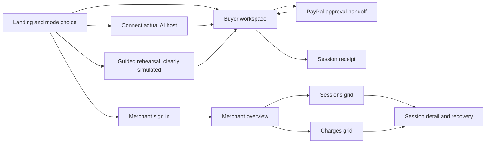

# Tollbooth interface and demo

**Status:** owner-requested UI rework, 2026-10-18. Installed with shadcn CLI **4.22.0**, registry style **base-nova**, Base UI primitives. Layout and concise-copy rules below supersede older visual wireframes. Financial state labels come from [DESIGN](DESIGN.md), never from optimistic frontend assumptions.

## 1. Information architecture



Routes: `/judge`, `/run/rehearsal`, `/receipts/rehearsal`, `/`, `/run/:sessionId`, `/connect`, `/receipts/:sessionId`, `/merchant/login`, `/merchant`, `/merchant/sessions`, `/merchant/charges`, `/merchant/sessions/:sessionId`, `/demo/merchant`. IDs alone never grant access. Shared static shell can be public; authenticated API responses enforce access. Browser refresh restores the session from DO via owner cookie. If credentials are missing, show a recovery explanation rather than a blank table or someone else's receipt.

English product copy throughout. The global badge distinguishes **Sandbox · No real money** from **Simulated · no AI or payment**. Amounts carry USD. Live AI versus scripted rehearsal is a second independent badge. Never put a simulated capture ID beside a PayPal logo without the simulation label.

## 2. Visual system and component selection

Use Vite + React + TypeScript + Tailwind and the **Base UI variant** of shadcn/ui. Choose a restrained neutral background, dark text, blue action color, green confirmed-payment state, amber waiting/recovery, red denied/review. Numeric values use tabular figures; currency always includes USD in summaries. State always includes text/icon as well as color.

Use the official `dashboard-01` block for merchant navigation/summary layout and `sidebar-07` for collapsible navigation. Adapt their layout to SPA routing and Base UI primitives; do not copy Next.js page/server imports or the block's default table dependency. Build buyer workspace and receipts from components, not an invented shadcn “payment block.” Verify the chosen registry variant during implementation; no block dependency should silently replace Base UI with Radix. [Official blocks](https://ui.shadcn.com/blocks), [Vite setup](https://ui.shadcn.com/docs/installation/vite), [Base UI Sidebar](https://ui.shadcn.com/docs/components/base/sidebar).

| Surface | shadcn components installed / used |
|---|---|
| Shared shell | Sidebar, Separator, Button, Badge, Tooltip, Sheet, Dropdown Menu |
| Start/setup/policy | Card, Field, Label, Input, Textarea, Select, Dialog |
| Execution workspace | Card, Progress, Table, Alert, Skeleton, Button |
| Approval and per-call consent | Dialog, Card, Badge, Button; explicit confirm/cancel controls |
| Receipt | Card, Separator, Table, Badge, Alert |
| Merchant login | Card, Field, Label, Input, Button, Alert |
| Empty/loading/recovery | Empty, Skeleton, Alert, Button |

Names are from the [component catalog](https://ui.shadcn.com/docs/components). Use a semantic HTML table for the small buyer ledger. AG Grid is for merchant sessions and charges. Avoid multiple competing table systems on the same merchant view.

## 3. Screen wireframes and behavior

### Landing and session setup

```text
Tollbooth                                  [Connect AI] [Merchant]
Open a session
[PayPal Sandbox • USD • No real money]

[ Run with your AI host ]   [ Guided rehearsal (scripted) ]

Tools                         Spending policy
market_lookup   $0.20          Session budget  [ $5.00 v ]
landed_cost     $0.35          Per-call cap    $0.50
Synthetic sample data         Ask me above    $0.30
                              Seller          tollbooth.demo

Usage is accrued per successful call. We settle it when you finish,
or after 15 idle minutes / 30 active minutes. Unused budget is not charged.
[Open session and review PayPal approval]
```

Budget input enforces 0.50–5.00 USD and shows integer-cent validation errors. Policy import/edit is available only before a session, with a strict schema and a readable summary. Changing a budget after authorization requires a new session and new approval. No card fields. No automatic sandbox-to-simulation fallback when credentials or PayPal fail.

### Connect actual AI

```text
Connect your AI host                         [Supported setup guide]
1. Open this buyer workspace.
2. Issue a scoped client credential for the adapter. [Issue access]
3. Add the MCP endpoint and credential to your trusted host/bridge.
4. Ask: “Compare coffee demand and a $45 parcel to Korea and Japan.”

[Endpoint: deployment /mcp] [Copy endpoint]
[Credential: hidden • expires in 60 minutes] [Copy once] [Hide]
[Connection test: waiting / tools discovered]
[Open live session view]
```

Show an exact tested host/version and adapter instructions once M1 establishes them. Credential is a sensitive client control value, never chat content. The UI can launch a guided rehearsal; actual external AI runs are started in the chosen host and observed here. The owner-authorized M5 Workers AI planner is available inside a buyer workspace; model identity and synthetic tool data remain explicit.

### Buyer workspace and approval

```text
Tollbooth / Session …                     [Actual AI • Sandbox]
[Awaiting approval / Active / Closing / Reconciling / Complete]

Approved limit    Accrued usage     In progress     Available
$5.00             $0.90             $0.00           $4.10
[================== usage bar + reserved segment ============]

Scripted tools (2/3 width)               Session ledger (1/3)
> Compare demand and landed costs       # Tool            Usage
Policy passed: market_lookup            1 market_lookup  $0.20
Human approval needed                   2 landed_cost KR $0.35
[Approve up to $5.00 with PayPal]        3 landed_cost JP $0.35
[I've approved: check status]            Replay #1        +$0.00
                                        Total accrued    $0.90
landed_cost $0.35 exceeds ask threshold
[Allow this call] [Decline]

Synthetic results + source label        [Finish and settle $0.90]
Last updated 14:03:22 KST                Auto-close in 14m 32s
```

The four money values come from one versioned DO snapshot. Available = budget − committed usage − reservations, not budget − captured amount. Before authorization, label the first card “Requested limit” and available as unavailable. Show an explicit reserved row while calls execute. A replay event can appear in activity but must not become a new billable ledger row.

PayPal approval opens a new tab with safe link handling; if popup blocked offer a normal link. Returning shows “Checking authorization,” not “Paid.” Decline/cancel stops new work and asks the server to close safely; a late authorization still receives zero-use cleanup. Per-call human decisions apply to the same call fingerprint; repeated identical transport requests do not prompt or charge again. Hard cap violation displays a blocked event with explanation and no override button.

Immediate mutation responses update the screen; while visible, poll DO snapshots every five seconds, back off during approval/reconciliation, pause in hidden tabs, stop after final state. This is bounded near-real-time reporting, not a guaranteed push stream. Show “Last updated” and an offline/stale indicator; do not decrease available budget optimistically before the server confirms reservation.

### Receipt

```text
Session receipt                              [PayPal Sandbox]
[Settled • payment confirmed]
Approved limit                                          USD 5.00
Successful usage (3 calls)                              USD 0.90
Captured once                                          USD 0.90
Unused authorized amount                               USD 4.10

Authorization: …     Capture: …     Verified at: …
Closure evidence: completed final capture
Unused amount was not charged. Payment-method hold updates may take time.

[View itemized usage] [Back to workspace] [Copy receipt summary]
```

A pending settlement instead has an amber “Settlement pending” title, accrued amount, last checked time, and a status refresh action. No “Paid,” success checkmark, or invented capture ID. Zero-use receipt says “Authorization voided; captured USD 0.00” with authorization ID and void request reference, never a void transaction ID. EXPIRED without authorization is “Session expired before authorization.” Receipt access is private, not an unauthenticated share link. Copy action excludes credentials and raw approval URLs.

### Merchant sign in

```text
Tollbooth merchant access
[Sandbox records are private]
Admin access secret [••••••••••••••••••••]
[Sign in]
Public example available: [Open simulated merchant dashboard]
```

Use the high-entropy secret login/cookie design in DESIGN. Do not keep the secret in browser persistent storage. Loading/error states reveal no merchant data. No signup, password reset email, or third-party account integration in the MVP.

### Merchant overview, sessions, and charges

```text
Sidebar                 Merchant overview          Sandbox [Sign out]
Overview                [Last projected at …] [Refresh]
Sessions                Gross captured   Accrued usage   Active   Review
Charges                 $0.90            $1.25           2        0
                        Date [Last 7 days]  State [All]  Search [     ]
                        -----------------------------------------------
                        Session | State | Budget | Used | Captured | Age
                        …       | Done  | $5.00  | $.90 | $.90     | 3m
                        …       | Active| $5.00  | $.35 | --       | 1m
                        -----------------------------------------------
                        [Previous page]     1–100       [Next page]
                        Totals apply to selected period, not this page.
```

`Sessions` grid columns: created time, short session reference, mode badge, state, budget, accrued, reserved, available (projection), captured, successful calls, last update, review reason. `Charges` grid: verified time, session, capture reference, settlement kind, provider status, amount, currency, release evidence. Gross captured excludes accrued/PENDING; no fee/net-profit estimate without provider facts.

AG Grid Community uses client-side row model on each bounded 100-row page, single-column sort, basic text/number/date filters, column resizing, cell renderers, and keyboard navigation. Application-level date/status filters and cursor controls drive D1 requests. Local grid filters/sorts are explicitly “This page”; global filters are above the grid. Detail is a separate route/Sheet, not Enterprise master/detail. Aggregates are application cards from D1 queries, not grid aggregation/pivot. No Enterprise server-side row model, Set Filter, advanced filtering, Excel export, integrated charts, Studio Agent Framework, or trial license. [Community feature matrix](https://www.ag-grid.com/react-data-grid/community-vs-enterprise/).

CSV export is optional and only for the visible redacted page using Community support; not a completion gate. Do not imply AG Grid sponsor eligibility guarantees a prize. Community's utility is a usable merchant table throughout judging, independent of trial expiry.

### Merchant detail and recovery

```text
Session …                         [Reconciliation needed]
Authoritative status checked at …   Dashboard projection updated at …
Budget $5.00  Used $.90  Reserved $0.00  Captured: unconfirmed

Timeline: opened -> authorized -> 3 completed calls -> capture unknown
Itemized usage: 20 + 35 + 35 = 90 cents
Provider evidence: last checked … ; pending / unavailable

[Recheck provider status]    No button to force a new capture
Reason: The response was lost; the existing payment is being checked.
```

If D1 is stale but direct DO detail is current, show both timestamps. If buyer state cannot be read, do not use a dashboard projection to allow spending. Recovery copy distinguishes “tool call unresolved,” “payment unresolved,” and “dashboard updating.” Error banners include a safe support reference, never an upstream stack or secret.

## 4. Responsive and accessibility acceptance

At 390px, stack amounts in a 2×2 layout, activity above ledger, navigation in Sheet, primary finish action beside the ledger without covering content. Merchant grids may scroll horizontally inside their container; the page itself must not overflow. Use meaningful row names and accessible details outside colored cells. Keyboard-only approval, close, login, pagination, and grid navigation must work. Return focus after dialogs, announce state transitions with a polite live region, and do not move focus on each poll. Verify loading, empty, denied, offline, slow approval, pending capture, terminal, stale projection, and unauthorized states. Money remains readable at 200% zoom.

## 5. Demo recording route (2 minutes 55 seconds)

| Time | Screen and proof |
|---|---|
| 0:00–0:15 | Introduce the small data seller and an AI needing two paid tools. Show “one approved limit, itemized usage.” |
| 0:15–0:35 | Actual AI host chooses coffee market data and KR/JP landed-cost comparisons. UI shows the payment-required event and $5 limit. Label actual AI and sandbox. |
| 0:35–1:00 | Buyer approves PayPal wallet. Show return/checking/ACTIVE sequence; blur buyer/account details. |
| 1:00–1:35 | Real AI executes three calls (20+35+35 cents). Show $0.90 accrued, $4.10 available, and required human call approvals. |
| 1:35–1:55 | Replay the first business key: +$0.00 and still three ledger rows. Show a $2 quote blocked by client policy as a labeled policy test, not an invented catalog tool. |
| 1:55–2:20 | Finish session; one completed $0.90 capture; receipt displays unused $4.10 without instant-refund language. |
| 2:20–2:40 | Merchant grid filters the session and opens charge detail. Show projection timestamp and gross capture. |
| 2:40–2:55 | Brief separately labeled timeout-recovery recording/test evidence, then architecture, public repo, and demo URL. |

Use genuine recorded runs; edits may remove waits but must not fabricate settlement or AI activity. Timeout demonstration can use an explicitly identified short test TTL. The real three-call path remains unchanged. Public video must be shorter than three minutes; target 2:55 rather than exactly 3:00. Keep buyer credentials, admin secret, client tokens, and private evidence off-screen.

## 6. Owner UI rework contract (2026-10-18)

- Use the CLI-installed base-nova components, not lookalike CSS markup. Merchant uses dashboard-01's SidebarProvider/SidebarInset/SiteHeader and summary Card layout, with sidebar-07 icon collapse, mobile Sheet, rail and keyboard shortcut. Generated sample charts, TanStack table, account data, and unused dependencies are removed; AG Grid Community remains the only merchant grid. No Next.js imports, Radix substitution, or Enterprise module.
- Buyer setup, workspace, consent, receipt, connect, rehearsal, judge, merchant login and details compose the same Card, Field/Input, Badge, Table, Alert, Dialog, Skeleton and Button system. Judge mode selection uses Tabs; merchant filters use Base UI Select; the menu uses Dropdown Menu. Separator and tooltips provide compact supporting detail.
- Use option 01's raised-barrier SVG mark plus real Tollbooth text. Original PNG references live in [brand](brand/README.md). SVG/favicon backgrounds and cutouts are transparent. No CSS letter logo.
- No eyebrow labels, marketing taglines, footer slogans, redundant state captions, or grid-help paragraphs. A route title, action label, required financial status, price, owner-access recovery, simulation/real distinction, and last-updated value may remain. Optional scope/model/setup explanations belong in details or tooltips; accessible names retain their meaning.
- Keep pending/unknown settlement unconfirmed, zero-use void wording, and non-guaranteed hold release. D1 lag versus current DO state must remain visible in detail. These rules take precedence over brevity.
- Base UI tooltips are supplementary visual hints; tests inspect their visible popup rather than assuming a `role=tooltip`. Scope instructions are also in the trigger's accessible name. See [Base UI tooltip guidance](https://base-ui.com/react/components/tooltip).

### Rework verification

172 unit/Workers/contract tests and 13 Playwright tests pass, including Base UI keyboard Select, mobile Sheet, icon collapse, consent focus return, tooltips, menus, reload, unknown/zero receipts and stale D1 detail. Deployed desktop/390px captures cover 13 route views (26 images); local provider-fixture captures cover consent and controlled failure states separately. Source images remain unchanged; favicon backgrounds are transparent.

Worker financial/API/MCP source is unchanged from M5; uploaded Worker size remains 757.72 KiB (gzip 175.08 KiB). UI assets, the MCP client adapter and AG Grid merchant module are separate browser chunks. Deployment `e04d0377-e65c-4731-9470-e8614617732a` passed SPA/MCP modern+legacy/payment-required/wrong-bearer smoke without creating orders.

The UI-run CPU check observed first modern connect/list samples of 13/18 ms, followed by paced repeats at <=5 ms connect and <=3 ms list. No `exceededCpu` occurred, but an all-cold-request 10 ms headroom gate is **not proven**. Do not discard those first samples or call unchanged source proof of unchanged latency. Cloudflare documents limited tolerance for occasional bursts; it is not a performance guarantee. [Workers CPU limits](https://developers.cloudflare.com/workers/platform/limits/#cpu-time). Complete measurements and screenshots live in the private UI evidence directory.
